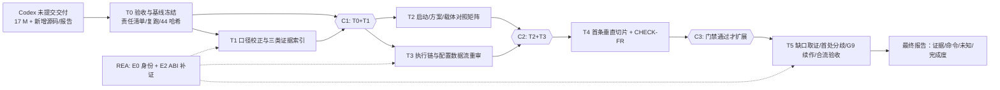

## Product Overview

按已交付的 CodeBuddy 接手基线，执行 Codex 会话在同一工作树留下的 VisionMaster 高保真逆向工作，从 T0「交付验收与基线冻结」开始按检查点逐级推进到 T5，最终形成可复核的源码恢复、证据索引、对照矩阵、垂直切片、差分与交接闭环。

## Core Features

- **T0 交付验收**：逐文件登记 Codex 未提交改动的责任与证据、在 CodeBuddy 侧复跑 Release 构建与核心回归、登记 44 份门禁产物哈希与状态、判定两个 `tool-lifecycle-*` 临时目录。
- **T1 口径与证据索引**：统一原厂证据根与四套进度口径的定义及权威级别；建立 Guide 配置写入/首次工具箱加载、方案实体成员链、MainWindow 与 MainWindowData/HostShell 三类原厂索引。
- **T2 对照矩阵**：完成启动/Guide/主窗口/方案对照矩阵，逐成员重审启动链、方案实体、工具载体与配置入口，仅在具备原厂证据时修复框架差异。
- **T3 链路重审**：重审 Run→Callback→Result→Stop/Cancel→Dispose 状态机与配置/ROI/Mask/显示/参数提交数据流，补齐字段读写、分支谓词、失败传播与释放边界。
- **T4 切片与门禁**：闭合 ImageSource→真实工具首条高保真垂直切片，执行 CHECK-FR 保真度门禁判定并更新账本与目标状态。
- **T5 缺口与发布**：缺失原件取证、原厂宿主首处分歧（原件缺失时保持 `unknown`）、G9 续作门槛判定、工作区链路合流验收、全量回归与最终报告。
- **状态与口径纪律**：任务状态只随实际执行逐项更新；每轮报告给出变更责任、证据路径与等级、命令与结果、未确认项与解除条件、完成度百分比及分母；缺失原件不伪造替代资产，测试通过不改写为 VM 等价。
- 界面外观在本轮不新增也不翻新，视觉表现沿用当前构建。

## Tech Stack Selection

沿用工作树现有技术栈，不引入新框架或新依赖：

- 产品代码：.NET / WPF / C# 解决方案，`src/VisionEditor`（25 个 `MainWindow.*.cs` 分部类）、`src/VisionEditor.Core`、`src/VisionPluginContracts`、`src/VisionPlugins.*`。
- 回归套件：`tests/` 下 313 个 `.csproj`（其中 290 个 `*Checks*`），已核实 `tests/ToolCatalogLifecycleChecks15/`、`tests/VisionEditor.WorkspaceProjectionChecks/`、`tests/VisionEditor.ShellMenuChecks/`、`tests/VisionEditor.ShellChecks/`、`tests/VisionEditor.StartupShellChecks/`、`tests/VisionEditor.WpfChecks/` 等路径。
- 取证：原厂反编译源码与资源位于 `analysis/decompiled`、`analysis/full-audit`（已核实 `VMControls.Data/VMControls.Data/ToolBoxData.cs`、`VisionMasterMain/VisionMaster.AppMainWindow/GuideWindow.xaml.cs`、`VisionMaster.Exe.Audit/VisionMaster/MainWindowData.cs`；`ToolBoxData.cs:231` 的 `ChangePriorityByInfo()` 存在）；原生/ABI 证据用 `[mcp:rea]` 与 `[skill:reverse-engineer-anything]`。
- 脚本与版本控制：PowerShell + Git；`HEAD = 31acdb4c`，`origin/main` 同值。
- 门禁与台账：`docs/VM-REVERSE-GATE-MATRIX-20261112.json`、`docs/VM-COMPLETE-REVERSE-IMPLEMENTATION-PLAN-20261112.md`、`docs/VM-EXECUTION-GOALS-20261112.md`、`docs/reverse/VM-fidelity-ledger-20261112.md`、`docs/framework-progress-audit.json`、`docs/SOURCE-LEVEL-REVERSE-PROGRESS.json`。

## Implementation Approach

**策略**：以「证据门禁驱动的阶段式接手」执行，不做一次性铺开。T0/T1 只做只读验收、哈希登记与口径校正，不触碰产品行为；T2/T3 先出对照矩阵与差异决定，再按 `implementationRule` 决定是否允许改代码；T4 只做一条垂直切片并过 CHECK-FR；T5 中依赖缺失原件的 T5.2 及人工验收、提交推送保持阻塞并显式报告，不因缺 `test1108.sol` 或匹配原厂环境而停止其余静态取证。

**关键决策与权衡**：

1. **先验收后实现**：Codex 的 17 个 `M` 建立在 `31acdb4c` 之上且未提交、未复跑，其 44 份 `*-completion.json` 属自述证据。先复跑构建与回归再引用其结论，避免把「未验证」传播成「已完成」；代价是 T0 消耗一轮构建/测试时间，但可防止后续全部结论建立在不可信基线上。
2. **无证据不改行为**：严格执行 `noEvidenceAction`。截图、用户反馈、`tasks/plan.md` 与 `tasks/todo.md` 的叙述只登记差异；原厂 `.sol` 未知字段、native ABI 参数、四类 `ToolGroup.xml` 排序值保持 `unknown`，取得原件后只补元数据并复跑，不改已有解析算法。
3. **不重做已完成索引**：`docs/reverse/C01-toolbox-type-priority-chain-20261112.md` 已闭合工具箱解析链，T1 重定位到另外三类索引，避免重复劳动与二次分叉。
4. **口径隔离**：对外完成度只用 10/10 = 100%（用户指定权威口径），框架实施口径 42/96 = 43.75% 单列；G1–G9 门禁数、128 stage gates、16/162 历史值均不并入分母，人工验收不计入。
5. **REA 用于证据补强而非替代源码阅读**：已反编译的 C# 托管源码用 `read_file`/`search_content` 直接取证即可；`[mcp:rea]` 集中在 E0 身份（MVID/PE/资源哈希）、E2 ABI（native 边界、寄存器/栈/虚表）与程序集成员差分，符合项目「native 伪代码需汇编/ABI 校验」的长期要求。
6. **不使用 subagent**：`AGENTS.md` 明确「Do not spawn subagents unless the user explicitly requests delegation」，故不调用 `code-explorer`；跨文件取证由主代理串行完成，构建严格串行以保证可控。

**性能与可靠性**：44 份门禁 JSON 的 SHA-256 用一次批量枚举完成，避免逐文件重复遍历；构建使用独立 `OutDir`、`UseSharedCompilation=false`、`BuildInParallel=false`，采用一次 Release 构建 + 按需增量测试，避免 300 余套件的 N 次全量编译；命令清单在 T0.3 冻结后再批量复跑，防止臆造参数导致的失败重试。时间复杂度为 O(阶段数 × 该阶段证据文件数)，瓶颈在 Release 构建与 WPF 无界面套件，通过串行 + 独立输出目录缓解。产物写入 `artifacts/`（已被 `.gitignore` 忽略）与 `docs/reverse/`，不污染产品程序集。

## Implementation Notes（执行细节）

- **已核实并可复用**：`docs/CODEBUDDY-TAKEOVER-PLAN-20261112.md` 与 `docs/CODEBUDDY-TAKEOVER-TASKS-20261112.md` 为权威基线；门禁 JSON 实测 **44 份**，而计划文档 §6 表格写「46 份门禁 JSON」，T1.1 需一并订正；任务清单第 9 节只登记了两条已验证命令，其余须先冻结 `csproj` 路径与参数。
- **证据根校正**：交接文档第 22–23 行的 `D:/MyWork/REA逆向测试/analysis/...` 实测不存在，全部报告统一改为工作树内 `analysis/decompiled`、`analysis/full-audit`；二者被 `.gitignore` 的 `analysis/*` 排除，报告中必须注明「远程不可移植」。
- **冻结清单**：`docs/CODEBUDDY-HANDOFF-20261112.md`、`tasks/plan.md`、`tasks/todo.md`、`AGENTS.md`、`worktrees/tool-plugins/` 一律不改、不勾选、不删除、不 reset；`src/VisionEditor/tool-lifecycle-*/` 只出判定报告，是否清理由用户决定。
- **日志与产物**：构建/测试原始日志、退出码、产物时间戳落到 `artifacts/codebuddy-verify/`；报告只记录路径与哈希，不倾倒大体积载荷，不记录设备/认证凭据。
- **合流防护**：T5.4 必须复跑 `NodeProjectionChecks`、`VisionEditor.WorkspaceProjectionChecks`、`VisionEditor.ShellMenuChecks`、`VisionEditor.ShellChecks`，确认历史行 `RowIndex/AddTime/Content`、树形模块结果、帮助页、菜单数据驱动不回退；节点边框 `Path + NormalModulePathStyle`、状态角标真实资源、参数窗口字段级对齐继续标为独立近似，不改称 `parity-closed`。
- **提交纪律**：接手阶段不自动提交 Codex 的未提交改动；提交与推送仅在用户明确要求时执行，且先 `git fetch` 检查分叉。

## Architecture Design

沿用现有分层，不引入新架构模式：`docs/VM-COMPLETE-REVERSE-IMPLEMENTATION-PLAN-20261112.md` 定义 E0–E5 证据等级、S0–S7 单元状态、VS0–VS8 垂直切片、FR0–FR4 纠偏切片与 §7 任务卡格式；`docs/VM-REVERSE-GATE-MATRIX-20261112.json` 定义 `fidelityRule`、`implementationRule`、`noEvidenceAction`、`criticalPathMinimum`、`releaseBlockers`；`docs/PARALLEL-WORK.md` 顶部 2026-10-22 规则定义 `main` / `tool-plugins` 所有权，跨项目接口写 `docs/CONTRACT-REQUESTS.md`（最新 FCR-038）。

数据流与门禁链：



`unknown` / `blocked` 项沿链路单独旁路登记，不阻塞不依赖原厂运行环境的静态取证。

## Directory Structure

本次执行以新增证据/报告文档为主，产品代码只在 T2.2/T2.3/T3.1/T3.2/T4.1 判定为「重写」且具备 E1/E3 证据时才修改。

```
d:/MyWork/Rea逆向/
├── docs/
│   ├── CODEBUDDY-TAKEOVER-PLAN-20261112.md   # [MODIFY] 唯一接手基线。T1.1 订正 §6「46 份门禁 JSON」为 44 份，统一证据根为 analysis/decompiled 与 analysis/full-audit，明确四套进度口径及权威级别；不改历史叙述与 AGENTS.md。
│   ├── CODEBUDDY-TAKEOVER-TASKS-20261112.md  # [MODIFY] 20 张任务卡状态台账。按实际执行逐项从 pending 改 completed/blocked，补齐 T0.3 冻结的复跑命令表，记录退出矩阵与首个失败。
│   ├── VM-EXECUTION-GOALS-20261112.md        # [MODIFY] 按 T4.2/T5 判定更新 G2–G9 状态字段，区分 source-confirmed / independent-contract / parity-closed。
│   ├── CONTRACT-REQUESTS.md                  # [MODIFY][条件] 仅当 T2.3/T5.3 出现跨项目公共合同需求时，按生产者/消费者/载荷/生命周期/兼容性/验收证据追加 FCR 条目。
│   └── reverse/
│       ├── T0-codex-takeover-acceptance-20261112.md  # [NEW] T0.1 责任清单：每个 M/?? 条目的来源、责任、是否已提交、证据路径四列。
│       ├── T0-gate-artifact-hashes-20261112.json     # [NEW] T0.3 44 份门禁 JSON 的 SHA-256、goal/status/nextGoal 及 CodeBuddy「未复跑」验收列。
│       ├── T0-replay-command-inventory-20261112.md   # [NEW] T0.2/T0.3 冻结各测试套件 csproj 路径、参数、预期产物与退出码，禁止臆造命令。
│       ├── T0-tool-lifecycle-verdict-20261112.md     # [NEW] T0.4 两个 tool-lifecycle-* 目录的保留/忽略/待定判定及依据、被跟踪 UI 资产清单。
│       ├── T1-evidence-index-20261112.md             # [NEW] T1 口径对照表 + Guide 配置写入/首次工具箱加载、方案实体成员链、MainWindow 对应矩阵，每条含证据路径、成员/RVA、观察、未知、复跑方法。
│       ├── T2-startup-solution-matrix-20261112.md    # [NEW] FR-02/FR-03 差异矩阵与逐成员对应表，每个差异标注 E0–E5 与「保留/重写/隔离/运行未确认」决定。
│       ├── T3-execution-config-dataflow-20261112.md  # [NEW] FR-04 状态转移表、FR-05 参数/ROI/Mask/显示数据流矩阵、native 边界 ABI 证据与 unverified 清单。
│       ├── T4-first-fidelity-slice-20261112.md       # [NEW] 首条垂直切片的输入身份、调用边、正反/边界/重复/保存重开/停止/释放回归与 E0–E5 标注。
│       ├── T5-original-asset-gap-20261112.md        # [NEW] 缺失原件身份清单、解除条件与「不生成替代资产」声明。
│       ├── T5-first-divergence-20261112.md          # [NEW][条件] G8 首处分歧报告；原件缺失时仅登记 unknown 与解除条件。
│       ├── T5-workspace-merge-acceptance-20261112.md # [NEW] 工作区链路合流回归结果与独立近似项清单。
│       ├── T5-final-delivery-20261112.md            # [NEW] 最终报告，含 5 项固定内容与完成度分母说明。
│       └── VM-fidelity-ledger-20261112.md            # [MODIFY] T4.2 重算账本，五个最大差异各有处理决定；independent-contract 不写成 parity-closed。
├── src/
│   ├── VisionEditor/Program.cs、StartupLaunch.cs、MainWindow.StartupSolution.cs、MainWindow.xaml*、MainWindow.ShellMenu.cs、MainWindow.WorkspaceProjection.cs、MainWindow.ModuleTree.cs、WorkflowCanvas.cs、ToolNavigation.cs、ToolDisplays.cs、SubprogramCallWindow.xaml.cs  # [MODIFY][条件] 仅在 T1/T2/T3/T5 判定为「重写」且具备 E1 源码链或 E3 受控运行证据时修改，同一文件单一提交所有者。
│   ├── VisionEditor.Core/ModuleRunLedger.cs、NodeResultProjection.cs  # [MODIFY][条件] 仅在 T3.2/T5.4 出现调用链证据支持的结果投影或账本偏差时修改；不回滚 Codex 已有修复。
│   └── VisionPluginContracts/ToolConfiguration*.cs  # [MODIFY][条件] 仅在 T3.2 公共配置合同有原厂模板/绑定/事件证据时修改，工具专属转换仍归 tool-plugins。
├── tests/                                   # [MODIFY][条件] 按 T0.3 冻结的命令表扩充断言；截图/导出辅助代码只放 tests，产品程序集不放取证逻辑。
├── artifacts/codebuddy-verify/              # [NEW] 构建/测试原始日志、退出码、产物时间戳与哈希；已被 .gitignore 忽略。
└── [不改动] tasks/plan.md、tasks/todo.md、docs/CODEBUDDY-HANDOFF-20261112.md、AGENTS.md、.gitignore、worktrees/tool-plugins/、docs/framework-progress-audit.json、docs/SOURCE-LEVEL-REVERSE-PROGRESS.json
```

## Key Code Structures

不新增跨模块接口或类型定义：本轮变更以证据文档、状态台账与经门禁放行的局部修复为主，现有 `MainWindow.*.cs` 分部类、`ModuleRunLedger`、`NodeResultProjection`、`ShellMenuCatalog` / `ShellCommandRouter`、`WorkflowCanvas` 的既有契约保持不变。唯一需要精确约定的数据结构是 `docs/reverse/T0-gate-artifact-hashes-20261112.json`：按门禁文件相对路径为键，记录 `sha256`、`goal`、`declaredStatus`、`nextGoal`、`codebuddyVerification`（固定初值「未复跑」，仅在 T0.2/T0.4 复跑通过后更新）与 `replayCommand`；报告不复制门禁 JSON 的大体积载荷，仅保存路径与哈希。

## Skill

- **reverse-engineer-anything**
- Purpose：为 T1.2/T1.3/T1.4 的原厂程序集身份冻结与 T3.1/T5.2 的 native/ABI 边界核查提供标准化的 shipped-artifact 取证流程，区分「反编译源码直接可读」与「必须 PE/汇编/ABI 校验」两类任务。
- Expected outcome：产出带原件路径、SHA-256、MVID/PE 身份与证据等级的 E0/E1/E2 记录；已反编译托管源码用仓库内文件直接取证，native 伪代码歧义点补寄存器/栈/虚表证据，无法取证处明确标为 `unknown`。

## MCP

- **rea**
- Purpose：用 `inspect_managed_artifact`、`inspect_managed_members`、`compare_managed_members` 固定原厂 DLL 的成员/签名/CIL 身份并支持 T1.3/T1.4 成员链索引；用 `open_binary`、`analyze_function`、`inspect_native_instruction`、`inspect_pe_imports`、`inspect_native_exports` 支撑 T3.1 native 资源完成边界与 T5.2 原厂宿主首处分歧的 E2 取证；用 `export_evidence_bundle` 固化可复跑证据。
- Expected outcome：每条关键调用边有可定位的原件身份、成员/RVA 与调用关系证据；native ABI 参数不由反编译签名推断；Evidence bundle 可复现、可比对，且所有结论区分 source-confirmed / native-confirmed / unverified。