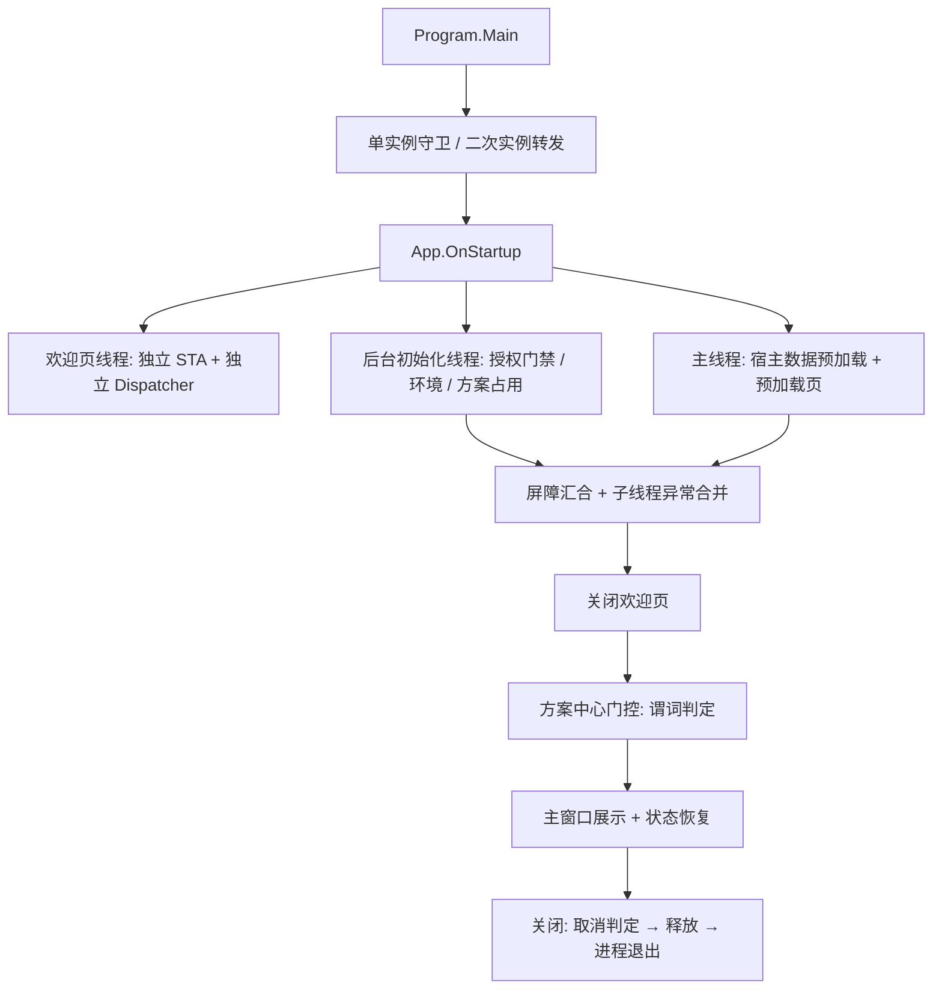

## 用户诉求

当前构建启动后，欢迎页（及方案中心）关闭后进程直接退出，且未产生任何异常日志。用户要求改变此前「逐点打补丁」的方式：**先完成原厂行为的完整逆向分析，再统一对照实现**，不再发布零散补丁。

## 产品概述

围绕桌面端视觉平台的宿主启动壳与其主窗口外壳，做一次「先取证、后重构」的整体替换：把原厂从进程入口到主窗口展示、再到关闭退出的完整时序，连同主窗口壳的菜单/工具栏、方案树、多文档页签、流程画布骨架与执行调度宿主接线，全部逆向成可执行契约，再一次性重写实现。

## 核心功能

**启动链**

- 进程入口、单实例守卫、二次实例命令行转发
- 授权门禁占位（跳过加密狗校验，保留接口与失败提示骨架）
- 欢迎页在独立线程与独立调度器上展示，不参与应用生命周期
- 后台初始化与主线程预加载并行，屏障同步后才关闭欢迎页
- 方案中心按原厂谓词决定是否弹出，返回结果驱动后续打开动作
- 命令行方案直启与「最近方案」恢复
- 主窗口展示、窗口状态恢复、关闭前释放顺序与最终退出路径

**主窗口壳**

- 宿主数据容器承载进度遮罩、运行模式、缩放与窗口状态
- 菜单/工具栏由原厂菜单数据驱动，方案树与多文档页签宿主侧组织
- 流程画布骨架与 Group、执行调度的宿主接线（不含工具内部实现）

## 视觉与交互效果

- 启动后可稳定看到欢迎页动画，随后进入方案中心（800×546 原厂布局与原始资源），选择后进入主窗口，全程不闪退
- 主窗口标题、菜单、工具栏、状态栏、左侧工具箱与画布区域按原厂产出的资源与层级呈现，窗口最大化/全屏/位置在下次启动时恢复
- 关闭主窗口时按原厂顺序释放并退出进程，无残留后台进程占用单实例
- 全程不出现授权弹窗阻塞；仅在授权接口占位缺失时给出原厂风格的失败提示结构

## 技术栈

- 语言与运行时：C# / .NET 10（`net10.0-windows`），WPF + WindowsForms 混合（沿用 `src/VisionEditor/VisionEditor.csproj` 现有 `<UseWPF>` / `<UseWindowsForms>`）
- 界面：既有 WPF XAML 与 `analysis/ui-assets/original-guide`、`analysis/ui-assets/wpf`、`analysis/ui-assets/catalog` 原始资源
- 框架层：`VisionFramework`（`GraphExecutor`、`SolutionExecutor`、`ModuleExecutionScope`）、`VisionPluginContracts`、`VisionEditor.Core`、`VisionModules`、`VisionWorkflow`
- 证据与核验：原厂反编译源码 `D:\MyWork\SunEyeVision_V2-param-window-datatree\docs\07-工具逆向\decompiled\HostShell\`（`ExeEntry\VisionMaster\{Program.cs, App.cs, MainWindowData.cs}`、`ExeEntry\VisionMaster.AppMainWindow\`、`Main\VisionMasterMain\` 等），辅以 `D:/MyWork/REA逆向测试/analysis/decompiled` 与 `analysis/full-audit`
- 构建约束（已在交接文档验证）：独立 `OutDir` + `-p:UseSharedCompilation=false` + `-p:BuildInParallel=false`，规避 `obj` 下 DLL 被占用

## 实施方案

### 总体策略

分三段推进，不交叉：

1. **契约冻结**：把原厂启动链还原成「入口 → 单实例 → 授权门禁 → 欢迎页线程 → 后台初始化 / 主线程预加载 → 屏障 → 方案中心门控 → 主窗口 → 关闭」的逐调用点表格，每个调用点标注成员全名、字段读写、分支谓词、异常出口与证据等级（源码确认 / 独立实现 / 运行未确认）。同一批把主窗口壳的宿主数据、菜单数据、方案树、页签、画布骨架、Group 与执行调度接线整理成同格式表格。
2. **对照矩阵**：以契约为左列，现有 `src/VisionEditor` 实现为右列，逐项判定「已对齐 / 偏差 / 缺失 / 独立实现」，并对每个偏差给出处置动作与影响面。矩阵必须解释「欢迎页后退出」的根因，且结论须能由源码证据支持，不能只给推断。
3. **统一重写**：一次性替换启动壳，再对齐主窗口壳。重写以契约行为为准，不复用现有 `Program.Main` 的零散时序。

### 关键决策与理由

- **引入 `App : Application` 承载启动时序**：原厂时序全部在 `App.OnStartup` 内，包含并行线程、两个 `AutoResetEvent` 屏障、子线程异常合并、`DoneException` 分支和 `Environment.Exit(0)` 关闭路径。现有 `Program.Main` + `DispatcherTimer` 结构无法表达这些语义，继续在 `Main` 里打补丁会持续产生生命周期偏差。`App` 用纯 C# 类实现（不新增 `App.xaml`），保留 `Program.Main` 作为显式入口，避免与 SDK 自动生成的入口点冲突。
- **欢迎页独立线程与独立调度器**：这是原厂结构，也是避免欢迎页参与 `Application.MainWindow` / `ShutdownMode` 生命周期的唯一可靠方式。现有实现把欢迎页建在 UI 线程上并用定时器关闭，任何 `ShutdownMode` 取值下都可能被帧关停逻辑牵连；改回原厂结构后，关停语义不再依赖对 `ShutdownMode` 的猜测。
- **授权只做接口占位**：按用户要求跳过加密狗校验。定义 `IAuthGate` 抽象与 `NullAuthGate`（放行）实现，保留原厂失败提示与授权提醒的调用点与 UI 结构，但不还原 `EncryptAPI` / `AccessManagerHelper` 的校验细节。所有涉及授权的契约条目显式标记「骨架，校验未实现」。
- **契约先落文档、后落代码**：本轮不发布止血补丁（用户已确认），因此契约与矩阵必须自包含到能指导一次性重写的程度，包括成员名、绑定路径、资源名、谓词顺序和异常出口。
- **复用既有逆向成果**：`docs/reverse/` 已有 203 份批次文档（如 `A05-entry-reconciliation-batch17.md`、`A05-shell-close-batch26.md`、`A06-close-dependency-batch13.md`、`A-entry-closure-batch20.md`），契约阶段必须做对账而不是从零重写，避免与既有结论冲突或重复取证。
- **性能与可靠性**：启动期把初始化放后台线程（原厂为 `ThreadPriority.Highest` 的 STA 线程），主线程只做预加载页与窗口构造，避免 UI 卡死；欢迎页资源走一次性加载缓存，不做重复解码；`IsStartTimerGC` 默认关闭，不引入周期性 `GC.Collect`；`DispatcherUnhandledException` / `AppDomain.UnhandledException` / `TaskScheduler.UnobservedTaskException` 三个入口按原厂分级记录，日志不写敏感信息。

### 实施注意

- 不修改工具插件工作树；不删除 `analysis/full-audit`；工作树有 105 个未提交改动，禁止 reset 或整树清理。
- 重写只替换 `src/VisionEditor` 的启动壳与主窗口壳接线，`VisionFramework` / `VisionPluginContracts` 的既有合同不动；如需新合同，按 `docs/CONTRACT-REQUESTS.md` 记录生产者、消费者、载荷、生命周期与验收证据。
- `tests/VisionEditor.StartupShellChecks` 通过反射调用 `StartupLaunch.CompleteInitialization`，启动壳重写后必须同步维护该探针，否则测试会静默失效。
- 现有 `MainWindow.xaml.cs` 为紧凑单行风格的大文件，重写时按 partial 文件职责拆分，避免把新逻辑继续塞进构造函数。
- 每条契约结论必须能回到可复核的源码路径或成员名；不确定的写「运行未确认」，不得按产品意图补全。

### 架构设计



启动壳与主窗口壳的边界：启动壳负责进程级生命周期与方案中心，主窗口壳负责宿主数据、菜单/工具栏、方案树、页签、画布骨架与执行调度接线；两者通过宿主数据容器与既有 `VisionEditor.Core` / `VisionFramework` 合同通信。

### 目录结构

```
Rea逆向/
├── src/VisionEditor/
│   ├── Program.cs                      # [MODIFY] 保留显式入口，移除定时器/内联时序，改为构造 App 并 Run；保留单实例守卫位置
│   ├── App.cs                          # [NEW] Application 子类，按契约实现 OnStartup 全时序：欢迎页线程、后台初始化、屏障、异常合并、方案中心门控、主窗口展示、关闭路径、三个未处理异常入口
│   ├── Startu
pLaunch.cs                          # [MODIFY] 拆为启动阶段状态与失败记录；移除与 App 重复的初始化线程，保留诊断日志与偏好读写
│   ├── StartupWelcomeWindow.xaml(.cs)   # [MODIFY] 改为独立 Dispatcher 宿主：自建线程、自管关闭、不设置 Application.MainWindow
│   ├── StartupGuideWindow.xaml(.cs)     # [MODIFY] 门控谓词移出窗口内部，改为由启动壳判定；返回结果结构化（打开/新建/不支持 .sol）
│   ├── MainWindowData.cs               # [NEW] 宿主数据容器：进度遮罩与遮罩消息属性、运行模式、缩放档位、窗口状态保存与恢复，对应原厂 MainWindowData.PreLoad 的等价职责
│   ├── ShellLifecycle.cs               # [NEW] 关闭取消判定、释放顺序与退出路径；IApplicationOperation 占位实现
│   ├── Licensing/AuthGate.cs           # [NEW] 授权接口占位：IAuthGate 抽象 + NullAuthGate 放行 + 原厂失败提示结构，不实现加密狗校验
│   ├── MainWindow.xaml(.cs)            # [MODIFY] 构造瘦身：接受宿主数据容器、绑定进度遮罩与遮罩消息、接入窗口状态恢复
│   └── MainWindow.Shell*.cs            # [MODIFY] 菜单/工具栏/最近方案/状态栏/窗口状态等 partial 按契约对齐数据来源与判定顺序
├── tests/VisionEditor.StartupShellChecks/
│   └── Program.cs                      # [MODIFY] 更新启动探针；新增欢迎页关闭不终止、方案中心门控、关闭路径、单实例、命令行分流、宿主数据绑定断言
└── docs/reverse/
    ├── C01-startup-chain-behavior-contract-20261111.md        # [NEW] 启动链逐调用点行为契约，含证据等级与未确认项
    ├── C01-shell-host-reconciliation-matrix-20261111.md       # [NEW] 原厂成员与现有实现的逐项对照矩阵与处置动作
    └── C01-startup-lifecycle-regression-20261111.md           # [NEW] 重写后的生命周期回归结果与人工验收记录
```

### 关键结构（授权占位）

```
internal interface IAuthGate
{
    // 返回放行/拒绝与失败提示键；本轮实现恒放行，不读取加密狗。
    AuthGateResult Evaluate();
}

internal readonly record struct AuthGateResult(bool Allowed, string? FailureMessageKey, string? ReminderMessageKey);
```

## Agent Extensions

### Skill

- **reverse-engineer-anything**
- Purpose: 驱动对原厂宿主程序集的取证流程，约束「反编译源码 → 成员核验 → 结论标注」的作业顺序，避免把推断写成源码确认
- Expected outcome: 契约文档中每条结论都带有可复核的证据来源与等级标注

### MCP

- **rea**
- Purpose: 对原厂 `VisionMaster.exe` 与 `VisionMasterMain.dll` 做成员级静态核验（`inspect_managed_artifact`、`inspect_managed_members`、`compare_managed_members`、`find_xrefs_to_name`），补足反编译源码缺失的成员体与调用边，例如方案中心显示谓词、关闭取消判定、宿主数据预加载与窗口状态恢复
- Expected outcome: 契约中标注为「源码确认」的条目均有成员名、签名或调用边证据；无法核验的条目明确标为「运行未确认」

### SubAgent

- **code-explorer**
- Purpose: 以 very thorough 级别扫描 `docs/reverse` 既有 203 份批次文档与 `src/VisionEditor` 全部启动/主窗口相关文件，建立既有结论索引与现有实现锚点清单
- Expected outcome: 输出可直接用于对照矩阵的「既有结论 ↔ 现有代码锚点」映射，避免重复取证与结论冲突