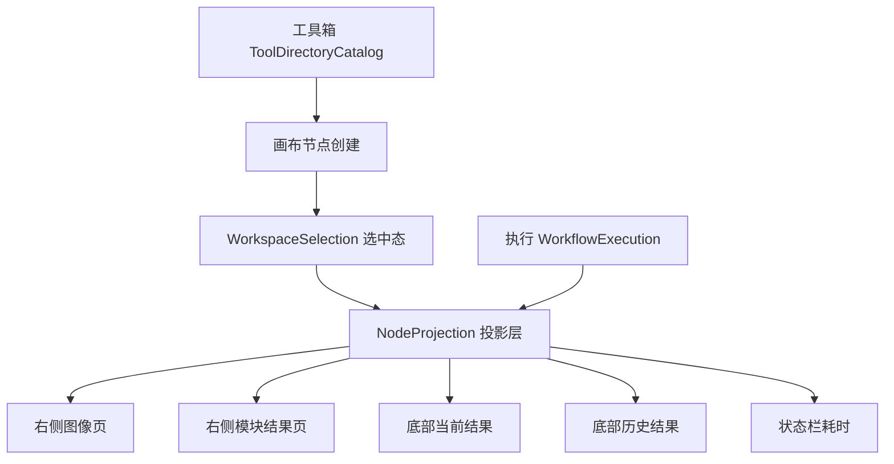

## 产品概述

针对桌面视觉平台的工作区四块区域（左侧工具箱、中间流程画布、执行链路、右侧图像与模块结果显示、底部当前结果/历史结果/帮助），先冻结可执行的区域契约，再按契约一次性重写并对齐结构、数据流、交互与展示。以 Blob 分析作为驱动工具，打通从工具箱入口到画布编辑、执行、右侧显示、底部结果展现的完整链路，并把这条链路固化为其他工具可直接照做的接入基线。

## 核心功能

- 区域契约冻结：区域划分、控件命名、状态机、事件、绑定、数据流，逐项标注证据等级
- 左侧工具箱：分类加载与优先级、悬停展开、搜索、拖拽源、禁用规则、ToolBoxType 过滤，折叠/展开两种宽度
- 中间画布：流程页签生命周期、节点与端口、连线创建与删除、框选、视口缩放平移、缩略图、撤销记录边界
- 执行链路：单次/连续/停止、运行态禁用与遮罩、流程/模块/算法三段耗时、异常与取消路径
- 右侧显示：图像页（图像源选择器、图像列表、预览、缩放）与模块结果页（按结果类型渲染），数据来源于节点输出
- 底部：当前结果、历史结果、帮助三块，历史行可回放，空值态统一
- 工具接入基线：接口契约、校验器、模板工具，并用第二个工具完成一次真实接入验证

## 视觉与交互效果

工作区在节点选中与切换、执行前后、结果为空与非空等状态下，各区域的数据与反馈保持一致：执行后右侧立即出现对应图像和结果，底部同步新增当前结果与历史行；节点切换时右侧与底部随之切换而不是残留上一节点数据；工具箱悬停展开与拖拽落点、画布框选与连线、缩略图导航均与原厂行为一致。所有未实现的入口保持可见但禁用并给出原因，不出现空白占位页面。

## 边界与验收

- 一次性成型：不发布中间态产品改动，最终统一构建、统一验收
- 测试行为以原厂 VM 为准，不以当前实现为准
- 基线可用标准：第二个工具按基线接入后即可完成工具箱入口、画布创建、执行、右侧显示、底部结果全流程

## 技术栈

- 语言与运行时：C# / .NET 10（`net10.0-windows`），WPF（沿用 `src/VisionEditor/VisionEditor.csproj` 的 `UseWPF` + `UseWindowsForms`）
- 界面：XAML + `ResourceDictionary`，沿用 `Styles/GuideWindowTheme.xaml`、`Styles/ShellMenuStrings.xaml` 的主题与文案机制
- 数据：`System.Text.Json` 校验与契约清单、`tool-catalog.json` 现有数据驱动先例
- 验证：新增 `tests/VisionEditor.WorkspaceBaselineChecks`，独立 `OutDir` + `-p:UseSharedCompilation=false` + `-p:BuildInParallel=false`

## 实施方案

### 总体策略

按用户要求的"从左到右一次成型"，分三段推进但不发布中间态：

1. **取证与契约**：先把原厂工作区复合控件的控件树、事件、绑定逆向出来，再用 15 张状态截图补几何/字体/色值，冻结四块契约与门禁。此段不碰产品代码。
2. **投影层先行**：原厂右侧与底部都是"节点数据的展现"，因此先建统一投影层（节点输出/图像/结果/耗时 → 视图模型），四块共用同一数据源，避免各区域各自取数造成不一致。
3. **逐区实现 + 统一验收**：按工具箱、画布、执行、右侧、底部顺序实现并各自补断言，最后统一构建、跑 `WorkspaceBaselineChecks`、出截图对照报告与台账更新。

### 关键决策

- **契约前置**：`VMControls.WPF.Release.VmMainViewConfigControl` 是本机唯一缺失的关键证据（全树仅命中调用点一处，`decompiled/WpfControls` 下只有 `VMControls.WPF`、`.Base.*`、`.CalibGuide`、`.CameraAcq`、`.DataForUI`、`.GlobalUI`、`.TimeDialog`，无 `.Release`）。因此第一个任务即解决取证，拿不到 DLL 时降级为截图 + 已有子控件源码反推，全部显式标 `运行未确认`，不把推断写成源码确认。
- **统一投影层而非各区域自取数**：现实现中右侧 `DynamicOutputPresentation`、底部 `FrameworkResultHistory`、状态栏耗时是三套取数路径，容易在节点切换时残留旧值。改为单一投影层 + `INotifyPropertyChanged` 推送，区域只做渲染，符合原厂 `SelectedModule` / `SectionChanged` 的单一选中驱动模型。
- **节点切换以选中态为唯一驱动**：原厂 `SelectedModule` TwoWay + `SectionChanged` → `SelectionChangedCommand`，即"切换节点"是所有区域刷新的触发源。实现上统一走一个 `WorkspaceSelection`，避免逐个控件手动刷新。
- **不造假、不占位**：未实现能力（全局变量、通信、脚本、相机管理、编辑运行界面等）保持禁用并在 ToolTip 说明原因，沿用已落地的 `ToolTipService.ShowOnDisabled` 做法。
- **既有失败只减不增**：`VisionEditor.ShellChecks` 存在两处既有失败（最近菜单计数 F1、新建方案当前流程 F2），改前记录失败清单作为基线，改后逐条比对。

### 实施注意

- `MainWindow.xaml` 与 `MainWindow.xaml.cs` 是紧凑单行风格的大文件，本批改造必须拆成新 partial（`MainWindow.Workspace*.cs`），不在原行内堆逻辑。
- 既有命名元素不能删除：`ToolRail`、`ProcedureTabs`、`DisplayTabs`、`ImageSelector`、`ImageList`、`HistoryGrid`、`ZoomSlider` 等被测试与交互逻辑引用，改造时保留并保持语义。
- `ToolExecutionScope.cs`（28.7KB）与 `WorkflowExecution.cs` 承载执行状态，改动需同步 `RefreshToolbarState` 的启用态，避免运行中按钮态回退。
- 每个区域实现后必须补该区断言，断言描述写"VM 行为"，并在收尾统一跑一次全量。
- 不修改工具插件工作树；不删除 `analysis/full-audit`；工作树已存在大量未提交改动，禁止 reset。

### 性能与可靠性

- 投影层使用增量更新：节点切换只重算选中节点相关视图，不全量重建结果表。
- 图像预览复用既有 `assetCache` 的缓存模式，按需解码、`CacheOption=OnLoad`、`Freeze()`，避免切换节点反复解码。
- 历史结果表虚拟化（`VirtualizingStackPanel`），避免多轮执行后行数增长造成卡顿。
- 所有区域渲染对空数据做显式空值态，不抛异常、不静默吞异常；异常统一落到状态栏与 `startup-error.log` 之外的运行日志路径。

### 依赖与阻塞

- **N1（硬阻塞）**：`VMControls.WPF.Release.dll`，用于反编译工作区复合控件。
- **N2**：15 张原厂状态截图（空画布 / 工具箱展开 / 工具箱搜索 / 节点未选中 / 节点选中含端口连线 / 参数窗口 / ROI 编辑 / 执行中 / 右侧图像页 / 右侧模块结果页 / 底部当前结果 / 底部历史结果多行 / 底部帮助 / 多页签加缩略图 / 框选或右键菜单）。
- **N3（可选）**：含 Blob 节点的 `.sol` 样本；缺失时用仓库 `examples/*.vmx.json` 自建。
- 降级路径：无 N1 时以 N2 与已有子控件源码反推，契约中相关条目一律标 `运行未确认`。

### 架构设计



职责边界：工具箱只负责分类与拖拽源，画布只负责节点与连线编辑，执行只负责调度与状态，投影层负责把节点数据翻译成各区域视图模型，区域只做渲染。

### 目录结构

```
Rea逆向/
├── src/VisionEditor/
│   ├── Workspace/WorkspaceContract.cs              # [NEW] 区域枚举、命名常量、状态机与事件契约的强类型定义
│   ├── Workspace/NodeProjection.cs                 # [NEW] 节点数据投影层：输出/图像/结果/耗时 → 视图模型，增量更新
│   ├── Workspace/WorkspaceSelection.cs             # [NEW] 统一选中态，节点切换唯一驱动源
│   ├── MainWindow.WorkspaceToolbox.cs              # [NEW] 工具箱区域：分类、悬停展开、搜索、拖拽源、禁用规则
│   ├── MainWindow.WorkspaceCanvas.cs               # [NEW] 画布区域接线：页签、节点、连线、框选、视口、缩略图
│   ├── MainWindow.WorkspaceDisplay.cs              # [NEW] 右侧图像页与模块结果页渲染
│   ├── MainWindow.WorkspaceBottom.cs               # [NEW] 底部当前结果/历史结果/帮助
│   ├── MainWindow.xaml                             # [MODIFY] 区域容器与命名保留，样式与布局按契约调整
│   ├── ToolNavigation.cs                           # [MODIFY] 改为由契约驱动分类与工具项，保留既有公共方法
│   ├── WorkflowExecution.cs                        # [MODIFY] 运行态推送统一走投影层
│   └── ToolExecutionScope.cs                       # [MODIFY] 执行状态与耗时改为事件推送
├── tests/VisionEditor.WorkspaceBaselineChecks/
│   └── Program.cs                                  # [NEW] 四块区域断言、节点切换一致性、Blob 全链路
└── docs/reverse/
    ├── W01-workspace-region-contract-20261111.md   # [NEW] 四块契约：区域/命名/状态机/事件/数据流/证据等级
    ├── W01-workspace-visual-baseline-20261111.md   # [NEW] 截图矩阵与几何/字体/色值测量表
    ├── W01-workspace-impact-inventory-20261111.md  # [NEW] 现有实现与测试断言影响清单、回归基线
    └── W01-tool-baseline-contract-20261111.md      # [NEW] 工具接入基线：接口、校验器、模板工具说明
```

### 关键结构

```
internal enum WorkspaceRegion { Toolbox, Canvas, Execution, Display, Bottom }

internal sealed record WorkspaceContractEntry(
    WorkspaceRegion Region,
    string Element,
    string SourceEvidence,      // 源码确认 / 独立实现 / 运行未确认
    string StateMachine,
    IReadOnlyList<string> Events);

internal interface IToolBaseline
{
    // 工具接入基线：工具箱条目、节点外观、输出类型、结果渲染、耗时口径
    ToolCatalogEntry CatalogEntry { get; }
    NodeVisualDescriptor NodeVisual { get; }
    IReadOnlyList<PortDescriptor> Inputs { get; }
    IReadOnlyList<PortDescriptor> Outputs { get; }
    IReadOnlyList<ResultDescriptor> Results { get; }
}
```

`IToolBaseline` 由 `ToolBaselineValidator` 六项校验（目录身份、端口完整性、输出类型、结果描述、耗时口径、空值态），不合规直接报错；模板工具作为最小实现供插件线照抄。

## Agent Extensions

### SubAgent

- **code-explorer**
- Purpose: 盘点四块区域现有实现、partial 拆分、既有测试断言与命名元素引用关系，产出改造影响清单与回归基线
- Expected outcome: 输出"区域 → 文件 → 命名元素 → 既有断言"四列映射表，并列出会被本批改动影响的测试用例与不可删除的命名元素

### Skill

- **reverse-engineer-anything**
- Purpose: 驱动 `VMControls.WPF.Release.dll` 的取证流程，约束"反编译 → 成员核验 → 结论标注"的作业顺序，避免把推断写成源码确认
- Expected outcome: 工作区复合控件及其子控件的类型、属性、事件、绑定清单，每条带证据来源与等级

### MCP

- **rea**
- Purpose: 对 `VMControls.WPF.Release.dll` 做成员级静态核验（`inspect_managed_artifact`、`inspect_managed_members`、`find_xrefs_to_name`、`compare_managed_members`），补足反编译源码缺失的成员体与调用边
- Expected outcome: 契约中标注"源码确认"的条目均有成员名、签名或调用边证据；无法核验的条目明确标为"运行未确认"