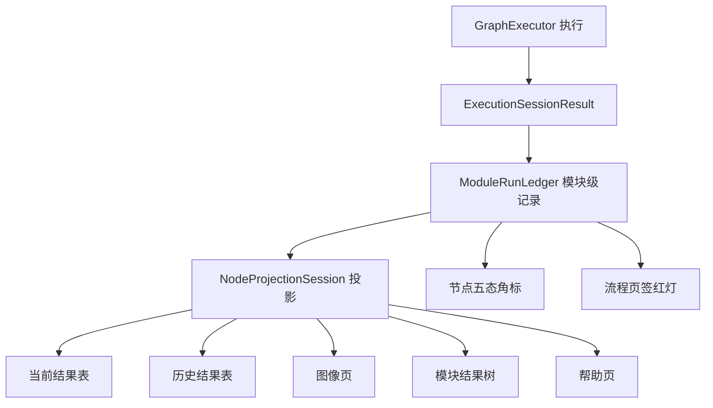

## Product Overview
工作区当前只做到"外观近似"：节点视觉、工作流引擎产出、右侧五个展示视图彼此没有共享同一份执行数据，导致执行一次工作流后，右侧仍然显示流程级摘要（如"流程名 · Success"），而不是原厂的模块级结果。本批要把执行结果下沉到模块粒度，并让右侧全部视图由这份数据驱动，使"执行工作流"后的整窗展示与原厂一致。

## Core Features
- 执行产出模块级记录：每条记录包含执行序号、时间、状态、耗时、各输出端口的值与图像
- 历史结果页按选中模块展示记录，三列为执行序号、时间、模块数据；模块数据形如"输出端口名 值"
- 当前结果页列由工具输出类型生成，支持一次执行多输出合并
- 图像页随选中节点切换：图像源下拉来自该节点的图像输出，缩略图列表与预览同步，保留 1:1、放大、缩小、分屏工具条
- 模块结果页改为树形：节点到输出端口到值、几何、图像
- 常用参数与数据队列两页按原厂默认折叠
- 节点视觉重构：本体 110×30、左侧 26 宽执行状态角标、路径式边框带阴影、编号与名称两列、悬停才出现四个连接点
- 执行五态（就绪、运行中、成功、NG、失败）回写节点角标，并联动流程页签红灯
- 切换节点或切换流程时清理列、图像与历史视图，同时按原厂策略保留缓存
- 帮助页展示工具自身帮助正文

## Visual Effect
执行后选中连通域节点，右侧依次呈现：图像页为该节点输出图与叠加标注；当前结果为六列表格；历史结果按执行序排列的模块数据行；模块结果树可展开端口；节点左上角出现状态色块与执行结果色。


## Tech Stack Selection
- 语言与框架：沿用现有 .NET 10 加 WPF（C#），不引入新依赖
- 数据层：`src/VisionFramework` 的 `NodeRunRecord`、`ExecutionSessionResult`、`ModuleDescriptor`、`PortValue`
- 校验方式：沿用仓库既有约定，使用控制台断言工程（输出 `PASS:` 行，退出码判定），不用 xUnit
- 证据来源：`analysis/decompiled` 下已反编译的原厂源码，不新增外部件

## Implementation Approach
核心是补一层"模块级执行账本"，把执行结果从流程摘要变成模块记录，再让右侧五视图全部从账本读取。原厂对应关系已由源码固定：

| 契约点 | 原厂证据 |
|---|---|
| 右侧整块只绑一个选中节点 | `VMControls.WPF/MainViewControl.xaml:33` 的 `ModuleResultView ModuleSource` |
| 换源重建列并清缓存 | `ModuleResultView.xaml.cs:439-469` 的 `DoSourceChanged` |
| 当前结果列由工具显示列表生成 | `ModuleResultView.xaml.cs:1494-1593` |
| 历史结果固定三列 | `ModuleResultView.xaml:304-320` |
| 节点本体 110×30、状态角标 26、四连接点 | `base/diagramitemtemplate.xaml:1126-1155` |
| 节点栅格与选中外框 | `VMControls.WPF.Base/DiagramConstInfo.cs` |
| 页签运行按钮双态 | `ProcedureConfigControl.xaml:390-423` |

关键决策：
- 账本放在 `VisionEditor.Core`（纯逻辑、可单测），WPF 只做绑定，避免把数据规则写进窗口
- 账本按 `(流程ID, 节点ID)` 分桶，每桶上限 500 条，写入 O(1)，读取按需投影
- 列结构仍按列签名增量重建，签名不变只替换行，避免每次执行全量重建 DataGrid
- 节点视觉抽成独立构建器，画布只负责摆放与几何，便于逐条对齐原厂模板

性能与可靠性：
- 执行结束一次性写入账本，UI 刷新走 `Dispatcher` 单次投递，避免每节点一次刷新
- 图像对象不复制，账本只持有引用与描述，避免大图重复拷贝
- 账本清空与流程替换绑定，防止跨方案残留；单测覆盖上限截断与筛选

## Architecture Design


## Directory Structure
```
src/VisionEditor.Core/ModuleRunLedger.cs            [NEW] 模块级执行账本：按流程与节点分桶，记录序号、时间、状态、耗时、端口值与图像，上限 500，提供按节点查询与清空接口
src/VisionEditor.Core/NodeResultProjection.cs       [MODIFY] 投影增加模块级行、多输出合并、历史行构造与帮助文本，保持列签名增量重建
src/VisionEditor.Core/ToolBaseline.cs               [MODIFY] 增加"账本可投影"校验：工具输出必须能生成当前结果列与历史行
src/VisionEditor/MainWindow.WorkspaceProjection.cs  [MODIFY] 从账本取数驱动五个视图，处理换节点与换流程的清理链
src/VisionEditor/NodeVisual.cs                      [NEW] 节点视觉构建器：110×30 本体、26 宽状态角标、路径边框与阴影、编号与名称两列、悬停四连接点
src/VisionEditor/WorkflowCanvas.cs                  [MODIFY] 改用 NodeVisual 构建节点卡片，几何与命中区保持 130×50，移除内联视觉代码
src/VisionEditor/MainWindow.NodeState.cs            [NEW] 执行五态回写：节点角标配色与页签红灯联动
src/VisionEditor/WorkflowExecution.cs               [MODIFY] 执行结束把 NodeRunRecord 写入账本，携带执行序号与完成时间
src/VisionEditor/MainWindow.FrameworkResultHistory.cs [MODIFY] 流程级摘要仅用于状态栏与日志，不再充当历史结果数据源
src/VisionEditor/MainWindow.xaml                    [MODIFY] 图像页工具条与缩略图绑定、模块结果树、常用参数与数据队列两页
tests/NodeProjectionChecks/Program.cs               [MODIFY] 增加账本与投影断言：模块级历史行、多输出合并、上限截断
tests/WorkspaceExecutionChainChecks/*               [NEW] 端到端断言：执行一次后五个视图的内容与切换节点后的清理
docs/reverse/W01-workspace-baseline-contract-20261111.md [MODIFY] 记录本批证据与验收口径
```

## Key Code Structures
```csharp
public sealed record ModuleRunEntry(
    long Sequence, DateTime At, string ProcedureId, string NodeId, string ModuleName,
    NodeRunStatus Status, double ElapsedMilliseconds,
    IReadOnlyDictionary<string, PortValue> Outputs);

public sealed class ModuleRunLedger
{
    public const int MaximumRecordsPerNode = 500;
    public void Append(ModuleRunEntry entry);
    public IReadOnlyList<ModuleRunEntry> ForNode(string procedureId, string nodeId);
    public void ClearProcedure(string procedureId);
    public void Clear();
}

public enum NodeVisualState { Ready, Running, Success, NoMatch, Failed }
```

## Implementation Notes
- 证据分级：凡取自原厂源码的结论标"源码确认"，行为推演标"独立实现"，无法运行验证的标"运行未确认"
- 不修改工具插件工作树，不删除 `analysis/full-audit`，工作树已有大量未提交改动，禁止 reset
- 构建使用独立 `OutDir`，加 `UseSharedCompilation=false` 与 `BuildInParallel=false`
- 既有失败项不得增加：`VisionEditor.ShellChecks` 两处、`VisionEditor.WpfChecks` 一处（已对照验证为既有问题），改后逐条比对
- 账本写入必须幂等于执行序号，避免连续运行时重复插入


## Agent Extensions
### SubAgent
- **code-explorer**
  - Purpose: 定位现有执行链路、画布节点构建、右侧面板绑定的全部调用点，避免遗漏改造面
  - Expected outcome: 产出"文件与方法级"改造清单，标注每个改动点的上下游依赖

### Skill
- **lsp-code-analysis**
  - Purpose: 对 `NodeRunRecord`、`NodeProjection`、`ModuleRunLedger` 做符号级引用检索，确认新增字段与改签名的影响范围
  - Expected outcome: 精确的引用清单，确保签名变更不漏调用点

- **reverse-engineer-anything**
  - Purpose: 按既有证据口径核对 `ModuleResultView`、`diagramitemtemplate`、`ProcedureConfigControl` 的契约细节
  - Expected outcome: 每条契约附文件与行号，并与实现逐条对照
