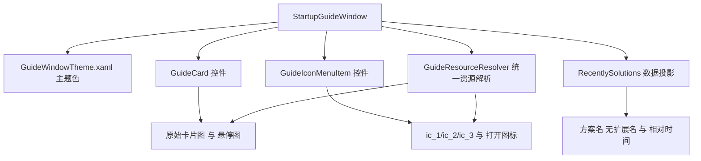

## 产品概述

把启动阶段的方案中心窗口（GuideWindow）从"能跑"提升到"与原厂一致"：以原厂反编译的 `GuideWindow.xaml`、`GuideWindow.xaml.cs` 和主题色字典为唯一依据，重写窗口外观、控件模板与数据投影，消除当前卡片被裁、列表头被切、纹理与配色缺失、复选框与关闭按钮自绘缺失等失真，并留下可复验的坐标与截图证据。

## 核心功能

**窗口外观**

- 800×546 固定尺寸，130px 标题栏 + 内容区（自适应 + 78px 底栏），1px 边框、4px 圆角
- 顶部 2px 红色描边；标题栏 `#131313` 到 `#1D1D1D` 垂直渐变；内容区 `#1D1D1D` 到 `#252525` 垂直渐变
- 内容区叠加 6×6 平铺对角虚线纹理，线色 `#171717`，与内容横线 `#FF1A1A1A`、右侧竖线 `#4D4D4D` 一致

**标题栏**

- 左：原厂 `guide_logo.png`（100×48，左边距 20、上边距 9）；旁边斜体版本号文案（暗灰 `#5C5C5C`）
- 右："不再显示"为自绘开关，使用原厂 `guide_check-box_off.png` / `guide_check-box_on.png`，文字左移 6px、整体下移 10px
- 最右：32×32 关闭按钮，悬停呈原厂风格的红色反馈，按钮整体下移 4px

**卡片区**

- 四张 188×130 卡片：通用方案、定位测量、缺陷检测、用于识别
- 边距按原厂非对称排布（首行底部 22、次行无下边距），区块固定贴底、上留 56px，整体高度正好 282，不再出现第二行被裁
- 卡片背景使用原厂 `guide_*.png` 与 `guide_*_click.png` 双态图；标题 18px 加粗，说明文字 11px；悬停时标题转白、说明文字转 `#F2F2F2` 并切换悬停图
- 卡片文字相对卡片顶端下移 10px，与原厂内容层级一致

**最近打开方案**

- 右侧 225px 列表，宽度与高度锚定卡片区块高度（282），不再压住表头
- 第一列标题"最近打开方案"（20px）；第二列表头即原厂文件夹图标 `guide_open_normal.png`，悬停/点击切换 `guide_open_click .png`
- 行内容为不带扩展名的方案名（16px，悬停转 `#E6E6E6`）+ 相对时间（14px 右对齐，如"今天/2天前/44天前"），行高 31、行间距 8，无选中高亮
- 双击行打开该方案；点击表头图标弹出打开文件对话框

**底部入口**

- 左侧 35px 起的三项菜单式入口，16px 字号，图标为原厂 `ic_1/ic_2/ic_3` 常态与悬停/点击图
- 项间为 1px 宽、40px 高的竖分隔线，左右留白 25/35
- 底栏背景 `#323232`，上缘 1px 分隔线；悬停时文字转主题橙 `#E76900`
- 三项依次为"学习使用VISIONMASTER""查看示例方案""获取更多支持和帮助"

## 视觉与交互效果

启动后欢迎页结束即进入一个与原厂截图几乎重合的方案中心：斜纹深色底、左上红条与橙色高亮呼应、四张卡片排布端正不被裁切、右侧最近方案列表表头完整、底部三个数字图标入口间距舒展。鼠标移到卡片、列表行、底部入口、关闭按钮时都有对应的图片/文字态变化，不再出现系统原生复选框或文字叉号。

## 技术栈选择

- 语言与运行时：C# / .NET 10，`net10.0-windows`，WPF（`UseWPF` + `UseWindowsForms`，沿用 `src/VisionEditor/VisionEditor.csproj`）
- 布局与样式：XAML + `ResourceDictionary`；自定义控件类承载依赖属性，模板用窗口资源中的 `Style`
- 像素与图片：`BitmapImage`（`CacheOption=OnLoad`）、`DrawingBrush`（平铺斜线）、`RenderTargetBitmap`（1:1 截图断言）
- 验证：`tests/VisionEditor.StartupShellChecks`（已有工程，已开放 internal），独立 `OutDir` 构建

## 实施方案

### 总体策略

以原厂 `GuideWindow.xaml` 为模板做"控件级移植"，而不是继续在现有近似 XAML 上修补：先建立与原厂同名的主题色资源键，再用与原厂同语义的自定义控件（`GuideButton` → `GuideCard`、`IconMenuItem` → `GuideIconMenuItem`）复刻模板与触发器，最后整体替换窗口 XAML 与代码后置，并用几何断言和 1:1 渲染截图锁住回归。

### 关键决策

1. **主题色集中成字典，不散落在窗口内联属性**：新增 `src/VisionEditor/Styles/GuideWindowTheme.xaml`，键名沿用原厂（`Col_GuideWindow_Background`、`Col_GuideWindow_Title_Background`、`Col_GuideWindow_Background_Line`、`Col_GuideWindow_CenterLine`、`Col_GuideWindow_RightLine`、`Col_GuideWindow_Spliter`、`Col_GuideWindow_Bottom_Background`、`Col_GuideWindow_ListView_Foreground`、`Col_GuideWindow_ListView_Selected_Foreground`、`Col_Window_TopFill`、`Col_Theme`），取值直接来自 `analysis/decompiled/Apps.ColorFun/colorstyle1.xaml` 与 `colorstyle.xaml`。好处：后续其它窗口可复用，且颜色可被单独审阅。

2. **自定义控件只带属性、不带外观**：`GuideCard : Button` 提供 `BackImage`、`BackImageClick`、`HelpContent`、`ToolBoxType` 四个依赖属性；`GuideIconMenuItem : MenuItem` 提供 `NormalIcon`、`HoverIcon`、`ClickIcon`。模板写在窗口资源里，视觉声明保持声明式，避免把模板塞进代码。这样可以彻底删掉现有的 `Tag`/`CommandParameter` 塞图片、靠文件名拼 `_click` 后缀的脆弱做法。

3. **几何全部取原厂常量**：窗口 800×546；标题栏 130；底栏 78；卡片区 `Margin=55,0,0,56`、`Width=412`、右下竖线 `#4D4D4D`；卡片 188×130、边距 `0,0,22,22 / 0,0,0,22 / 0,0,22,0 / 无`；列表 `Width=225`、`Margin=0,0,58,56`、高度绑定卡片容器；列宽 140/80；分隔条 `2×20` 位于 `0,6,290,0`；底部菜单 `Margin=35,0,0,0`、分隔线 `1×40` 间距 `25/35`。当前"卡片被裁""表头被切"的根因就是这两处高度预算漏算，改用原厂常量后自然消失。

4. **窗口 chrome 用原生等价实现**：原厂是 `VM.Controls.BaseWindow`（我们在本仓库无法引用），改用 `WindowStyle=None` + 根 `Border`（`CornerRadius=4`、`BorderThickness=1`、边框 `#404040`）+ 标题栏 `MouseLeftButtonDown` 调用 `DragMove`。这是"独立等价实现"，需在报告中显式标注；不引入 `AllowsTransparency`，避免关掉硬件加速。

5. **资源文件名怪癖按证据处理**：`analysis/ui-assets/original-guide/` 中打开图标的点击态文件名在 `click` 与 `.png` 之间带一个空格（`guide_open_click .png`）。方案是在 csproj 里为该单文件追加一条显式 `Content` 映射，输出成规范名；代码侧再写一个解析器按"规范名 → 原名 → 缺失"顺序查找，缺失时降级为常态图。这样既保留原始字节，也不把怪癖扩散到代码里。

6. **数据投影对齐**：`RecentlySolutions` 依赖属性保留，元素改为"方案名（去扩展名）+ 完整路径 + 相对时间"，列表显示去扩展名名称（ToolTip 为完整路径）与 `今天/N天前` 文案；超过 99 天的记录按原厂语义过滤。相对时间与截断规则属于独立实现，需要在文档里标注。

7. **不改启动链**：`App.cs`、`Program.cs`、`StartupLaunch.cs`、`MainWindow*` 一律不动；只改方案中心窗口、其控件、其测试和文档。

### 性能与可靠性

- 图片一次性加载并缓存到静态字典，`BitmapImage` 使用 `CacheOption=OnLoad`，避免窗口每次打开重复解码与文件句柄占用（原来每次构造都 `new BitmapImage(uri)`）。
- 斜纹背景用一个共享 `DrawingBrush`，不做逐元素绘制；不引入动画或定时器。
- 所有资源查找走统一解析器并带空值保护，任一图片缺失只降级不抛异常，保证窗口始终能打开（启动链已经不允许因为 UI 资源异常而退出）。
- 视觉回归用 `RenderTargetBitmap` 在测试进程内1:1渲染，不依赖外部截图工具，也不会在用户桌面上弹窗。

### 实施注意

- 测试锚点会变更：现有断言依赖 `Tag`/`CommandParameter` 是 `BitmapImage`、底部 `FooterIcon1/2/3`、`OpenFileIcon` 独立按钮、`HideGuide` 是 `CheckBox`。重写后改为断言 `GuideCard` 的 `BackImage`/`BackImageClick`、底部菜单三项的 `NormalIcon`/`HoverIcon`、列头打开图标、`GuideIconMenuItem` 数量与分隔线数量，并新增几何断言（卡片区底部不越界、列表高度等于卡片区高度），强度不降。
- 编辑 `StartupGuideWindow.xaml` 时注意 `Window.Resources` 与合并字典顺序；主题字典必须最先合并，模板中的 `DynamicResource` 才能解析。
- 旧 XAML 内联的 `GuideCard`/`FooterButton` 样式整体删除，不允许新旧样式并存，否则触发条件会互相覆盖。
- 不修改工具插件工作树，不删除 `analysis/full-audit`，工作树存在大量未提交改动，禁止 reset。

## 架构设计



窗口只负责布局与事件；颜色在字典、外观在模板、数据在投影、资源在解析器，四者解耦，后续其它窗口可直接复用字典与控件。

## 目录结构

```
Rea逆向/
├── src/VisionEditor/
│   ├── StartupGuideWindow.xaml              # [MODIFY] 整体重写：chrome、标题栏、卡片区、最近方案列表、底部菜单；删除旧的内联样式与绝对定位按钮
│   ├── StartupGuideWindow.xaml.cs           # [MODIFY] 重写构造与交互：资源解析、数据投影、加载态复选框、卡片点击写 ToolBoxType、关闭/示例/打开文件语义
│   ├── GuideControls.cs                     # [NEW] GuideCard(Button) 与 GuideIconMenuItem(MenuItem) 依赖属性定义；不含外观模板
│   ├── GuideResourceResolver.cs             # [NEW] 原厂 UI 资源查找与缓存：规范名/原名回退、缺失降级、BitmapImage OnLoad
│   └── Styles/GuideWindowTheme.xaml         # [NEW] 与原厂同键名的主题色与渐变字典，取自 colorstyle1.xaml 与 colorstyle.xaml
├── src/VisionEditor/VisionEditor.csproj     # [MODIFY] 为 guide_open_click 单文件追加规范化 Content 映射，确保输出名可用
├── tests/VisionEditor.StartupShellChecks/
│   └── Program.cs                           # [MODIFY] 更新方案中心断言到新控件，新增几何不越界断言与 1:1 渲染截图
└── docs/reverse/
    ├── C01-guide-window-visual-parity-20261111.md   # [NEW] 原厂与实现逐项坐标/颜色/字体/资源对照，偏差与独立实现清单，验收截图路径
    └── C01-startup-implementation-gate.json        # [MODIFY] 追加视觉对齐证据条目与计划项状态
```

## 关键结构

```
// 对应原厂 appMainWindow:GuideButton 的四个依赖属性
public sealed class GuideCard : System.Windows.Controls.Button
{
    public System.Windows.Media.ImageSource? BackImage { get; set; }
    public System.Windows.Media.ImageSource? BackImageClick { get; set; }
    public string? HelpContent { get; set; }
    public string? ToolBoxType { get; set; }
}
```

`GuideCard.ToolBoxType` 取值沿用原厂字符串（General / Position / Defect / Recognition），点击时写入配置项 `ToolBoxType`；`GuideIconMenuItem` 的三个图标属性为 `ImageSource`，模板内用触发器在 `IsMouseOver`/`IsPressed` 间切换。