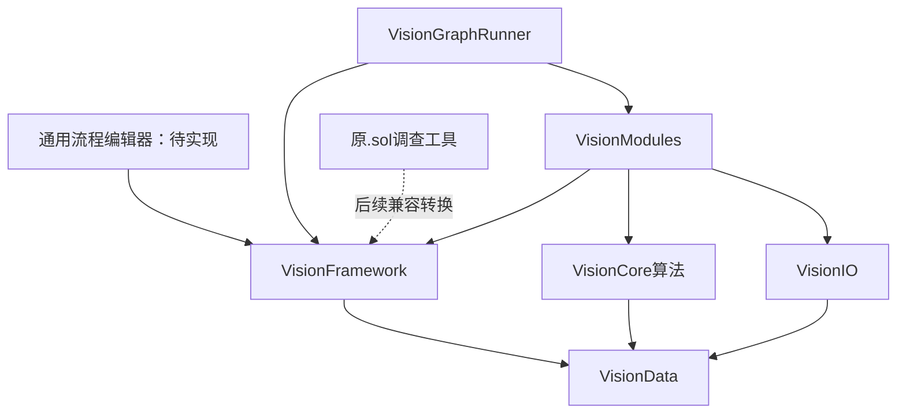

# 独立 VM 重建架构

本轮实现方案主体与无界面执行后端。结构为独立设计；尚未证明与原 VM 架构或行为等价。原程序行为证据保存在 analysis，重建实现不得把推导当作已观察运行。

## 工程边界

| 工程 | 职责 | 依赖 |
|---|---|---|
| VisionData | 不可变灰度图、点、圆、连通域值 | 无 |
| VisionFramework | 方案、模块契约、端口、ROI、资源、持久化、验证与调度 | VisionData |
| VisionCore | 独立算法实现 | VisionData |
| VisionIO | BMP读取 | VisionData |
| VisionModules | 可注册的内置模块适配 | Framework、Core、IO |
| VisionGraphRunner | 通用CLI方案创建、验证、执行 | Framework、Modules |
| VisionWorkbench / VisionWorkflow | 之前的找圆验证界面与固定链路 | 保留实验入口，尚未接入主图编辑器 |
| SolutionInspector | 原.sol的只读格式调查 | 与独立运行后端分离 |

VisionData 暂保留 VisionCore 命名空间以保持此前源码引用；程序集已物理分离。主框架不引用算法库。当前没有外部DLL插件发现/卸载，ModuleRegistry提供受版本标识的工厂注册扩展点。

## 模型

SolutionDocument包含版本、ID、名称、多个ProcedureDocument及ResourceDocument。流程包含节点与端口连接；节点包含模块ID/版本、名称、显式参数、编辑器坐标、启用状态、超时与ROI集合。支持矩形、圆、环和多边形ROI的数据表示和基本合法性校验；尚未实现ROI掩膜、fixture变换、角度范围、自交检查或图形编辑。

独立文件格式 *.vmx.json，FormatVersion=1。不是原.sol兼容写入格式。未知文档字段、重复JSON字段、未来版本和悬空节点连接拒绝。保存先校验、写同目录临时文件、flush再替换，失败不得破坏原文件；跨进程协作锁和嵌入资源打包尚未实现。

## 模块与数据

IModule声明ModuleDescriptor并实现ExecuteAsync。描述包含版本、输入输出端口、参数类型和范围。每个节点每次运行由factory创建实例，执行后Dispose/DisposeAsync。描述在注册时冻结；registry尚未支持运行期间热更新。

PortValue显式区分GrayImage、Number、Integer、Boolean、Text、Components、Circle。不自动把整数转double，也不进行字符串隐式转换。后续需要显式类型转换模块。

ModuleStatus：Success、NoMatch、Failed。NodeRunStatus另有Running、Skipped、Cancelled、TimedOut。SessionStatus.Success只代表没有运行错误，不代表所有检测目标存在或全部业务判断合格。比较输出Passed=false也可以是正常执行。

## 调度与错误

当前为稳定、顺序DAG执行，拓扑顺序在多个可执行节点间沿文档节点顺序决定。允许fan-out，输入端口只能单绑定。检查模块/版本、端口方向和类型、必填输入、参数类型/范围、重复节点/连接、环及禁用节点依赖。环明确拒绝，没有模拟循环。

运行期间使用节点参数、连接及ROI快照；进度观察器不能修改当前运行快照，观察器异常不影响算法。节点结果保存类型化输出、错误和耗时。上游失败或被连接输出缺失时，下游跳过并无输出；独立链路继续执行。

取消与超时为协作机制，仍等待实际模块结束并释放资源，不遗弃后台任务。内置同步算法只在开始/结束检查取消，因此不能保证中途即时停止。硬超时需要后续进程隔离。

资源目录按方案所在目录解析相对路径；SolutionExecutor在执行前校验所有声明资源和可选SHA256。直接使用GraphExecutor只运行流程，不校验Solution资源。预校验不是输入文件的全程不可变快照，算法模块仍通过Path读取，后续需要按资源ID统一获取。

## 首批模块

- vision.image-file：文件BMP图像源。
- vision.threshold：阈值分割。
- vision.components：8邻域连通域及数量。
- vision.circle：独立径向找圆，显式ROI/采样参数。
- logic.number-compare：数值判断。

版本均1.0.0。实现及限制见 src/VisionModules/README.md。没有原厂DLL依赖，也没有原厂数值等价结论。

## 当前验证与下一阶段

examples/architecture-demo.vmx.json 是五节点、四连接的两条链路：图像源→阈值→连通域；图像源→找圆→半径比较。保存再加载后执行成功。

验证涵盖模型保存、ROI、资源身份、端口类型、拓扑顺序、失败传播、无匹配、取消/超时、销毁、快照隔离，以及真实内置模块的集成链路。可用tests目录重复运行。

下一阶段建设通用流程编辑器：模块工具箱、节点拖放、端口连线、参数面板、图像/ROI编辑、撤销重做和保存重开；直接调用本框架。分支循环、断点单步、并发、相机/通信、原.sol往返与SDK兼容仍在后续里程碑。
