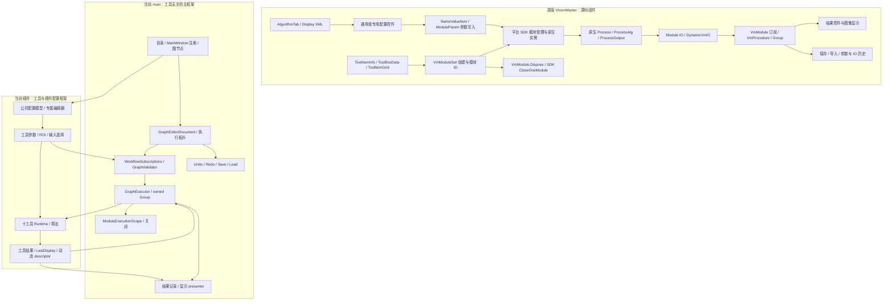
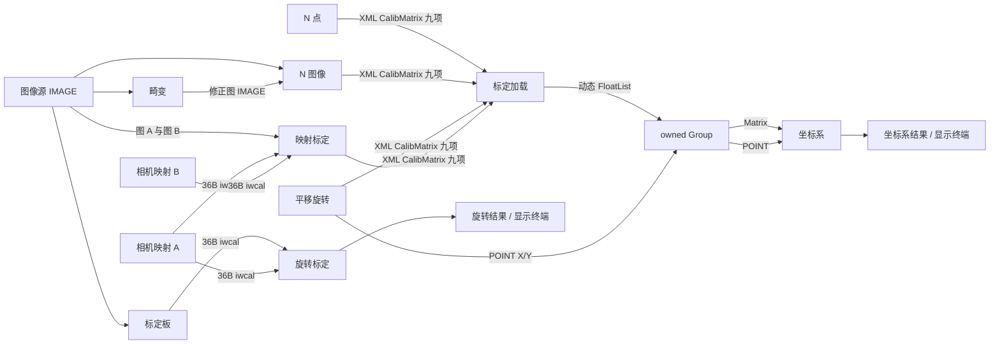
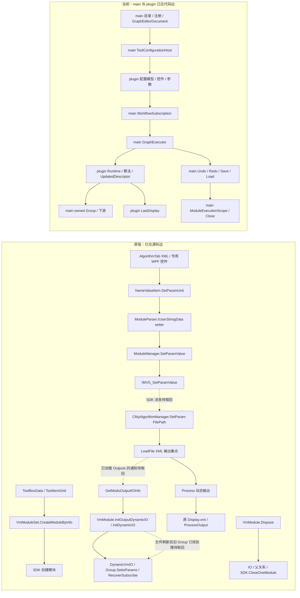

# 标定十工具跨项目完整架构图（范围全覆盖；调用边按证据分级）

面向阅读的离线交互版：[打开 HTML 架构图](calibration-architecture.html)。可切换总架构、十工具数据流、逐工具索引和断链清单；点击节点查看原版依据、当前实现及待证边。

这张图回答“架构分工文档之外，原版程序究竟怎样把框架与工具接起来”。**范围覆盖完整**：十个标定工具及共同宿主、配置、执行、数据交接、显示、历史和释放均在图中；**逆向证据尚未完整**：实线仅表示注明来源的已见源码或当前实测边，虚线表示需要定点取回的原版调用边，不把设计猜测画成事实。十项各自的 J01–J12 分支细节仍以[B 六工具矩阵](20261020-calibration-b-six-j-matrix.md)、[C 四工具矩阵](20261020-calibration-c-four-j-matrix.md)为准。图像源和 Group 只画与标定交接有关的边。

## 1. 原版分层与当前项目所有权

上图中原版组件关系的源入口分别见[创建链](20261020-pass13-calibration-create-call-chain.md)、[配置/文件参数链](20261020-pass17-readcalib-native-callback.md)、[Group/动态 IO 历史](20261020-pass15-readcalib-dynamic-history-boundary.md)及[释放链](20261020-pass17-calibration-lifecycle.md)。这是**代码所在层与已见入口**，不是声称十工具每个原版按钮、参数和算法分支都已逐边闭合。当前 main/plugin 分界以[所有权文档](../PLUGIN-FRAMEWORK-BOUNDARY.md)和当前源码为准；插件配置模型不在 main 再造一份。

## 2. 十工具源身份、UI/后台归属和结果角色

| 工具 | 原版模块与 UI 入口 | 当前插件后台/配置归属 | 在标定链中的已见角色 |
|---|---|---|---|
| N 点标定 | `IMVSNPointCalibModu` 原生+Cs+Control，点表字段事件 | `vision.n-point-calibration`，Calibration 插件 | 点对→求解→XML 九项矩阵 |
| N 图像标定 | `IMVSNImageCalibModu` 原生+Cs+Control，图像/批次配置 | `vision.n-image-calibration`，Calibration 插件 | 多帧图→批次求解→XML 九项矩阵 |
| 标定板标定 | `IMVSCalibBoardCalibModu` 原生+Cs，XML 配置/ROI | `vision.calibration-board`，CalibrationBoard 插件 | 图像/ROI→板点→36B `.iwcal` |
| 相机映射 | `IMVSCameraMapModu` 原生+Cs，点对配置 | `vision.camera-mapping`，CameraMapping 插件 | 点对→36B `.iwcal` |
| 映射标定 | `IMVSMapCalibModu` 原生+Cs，双文件或双 IMAGE | `vision.map-calibration`，MapCalibration 插件 | 双文件或双图→XML 九项矩阵 |
| 畸变标定 | `IMVSImageCalibModu` 原生+Cs，IMAGE/ROI | `vision.distortion-calibration`，DistortionCalibration 插件 | 图像→修正图；可供 N 图像标定 |
| 平移旋转标定 | `TranslationCalibModu` 原生+Cs+Control，点/模式配置 | `vision.translation-calibration`，Calibration 插件 | 点/变换→XML 九项矩阵及 POINT |
| 旋转标定 | `RotateCalibModu` 原生+Cs，图像声明/路径/采样 | `vision.rotate-calibration`，Calibration 插件 | `.iwcal` + 连续采样→旋转结果 |
| 坐标系 | `CoordinateModule` 原生+Cs+Cpp，IMAGE/POINT/Matrix/ROI | `vision.coordinate-module`，CoordinateModule 插件 | 矩阵/点/图→坐标系结果终端 |
| 标定加载 | `ReadCalibFileModu` 原生+Cs+Control，文件/刷新配置 | `vision.read-calib-file`，Calibration 插件 | XML→动态矩阵输出→Group/坐标系 |

原十项目录、主 XML、ToolItemInfo、DLL/Control 的逐件 SHA 和唯一别名差异见[原件身份](20261020-pass6-calibration-original-identity.md)；右列是**当前重建版**模块 ID，不是原厂 SDK 数值 ID。当前目录 `HEAD` 中 N 图像/相机映射的两项映射仍只在用户已有未提交工作区，故“当前可实例化”不等于“目录映射已提交”。每行独有 UI 事件、算法分支、错误释放与原/当前成员映射继续受 J 矩阵约束。

## 3. 标定数据生产、消费与格式边界

**实线表示已在当前真实图或原文件结构证实的具名路径**，不表示原版同构整图已经执行，也不表示原生算法全域数值等价。XML 九 float、36B `.iwcal`、IMAGE、POINT 和动态 FloatList 是不同载荷，不能凭“标定数据”四字互接。各边证据见[十工具去重索引](20261020-calibration-only-joint-audit.md)的第六至十三轮结果链及 [B/C 矩阵](20261020-calibration-b-six-j-matrix.md)；旋转和坐标系未发现本目标内合法后继时仅作为已证输出终端，不虚构消费者。

## 4. 一个必须追到底的动态端口实例

原版上游入口见[第十三轮创建链](20261020-pass13-calibration-create-call-chain.md)；文件控件→托管写参→原生 setter、输出懒读的成员/哈希见[第十七轮 FilePath](20261020-pass17-readcalib-native-callback.md)；动态 IO 手动编辑历史与文件刷新**不能等同**，见[第十五轮](20261020-pass15-readcalib-dynamic-history-boundary.md)；原/当前删除边见[第十七轮生命周期](20261020-pass17-calibration-lifecycle.md)。当前动态文件改名→warm/cold Group 的实测分叉见[第十七轮 Group](20261020-pass17-readcalib-group-history.md)。

这不是已完成的全十工具执行图：每个工具的专属控件事件/参数字段、原生分支与消费路径必须在矩阵中逐条连到共用节点；不能用这里的一个 `plugin Runtime` 方框替代算法追踪。下一步按虚线的原始 caller 和十项专属未闭边继续取回源码；**先审原图完整性，再审实现和探针**。main 维护框架/Group/调度图，`tool-plugins` 维护插件配置/工具算法图，交叉边只在 [FCR 台账](../CONTRACT-REQUESTS.md)交接，用户选择采用时点。
