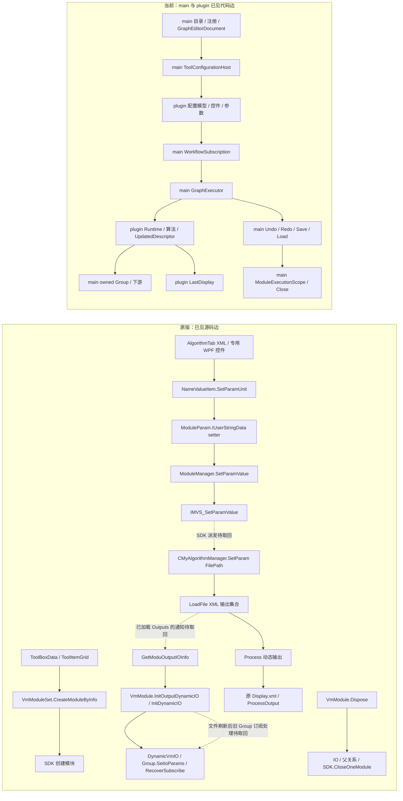

# 标定十工具跨项目源码调用图（工作底图）

这张图回答“架构分工文档之外，原版程序究竟怎样把框架与工具接起来”。它由已取原体和实测链构成，虚线表示**尚需继续取回的具体调用边**，不是推断原版行为。十工具独有 UI/算法/输出依[唯一对象表](20261020-calibration-only-joint-audit.md)和 B/C 的 120 格矩阵挂到这些共用边；非标定工具只作为必要图像源或 Group 接口出现。

原版上游入口见[第十三轮创建链](20261020-pass13-calibration-create-call-chain.md)；文件控件→托管写参→原生 setter、输出懒读的成员/哈希见[第十七轮 FilePath](20261020-pass17-readcalib-native-callback.md)；动态 IO 手动编辑历史与文件刷新**不能等同**，见[第十五轮](20261020-pass15-readcalib-dynamic-history-boundary.md)；原/当前删除边见[第十七轮生命周期](20261020-pass17-calibration-lifecycle.md)。当前动态文件改名→warm/cold Group 的实测分叉见[第十七轮 Group](20261020-pass17-readcalib-group-history.md)。

这不是已完成的全十工具执行图：每个工具的专属控件事件/参数字段、原生分支与消费路径必须在矩阵中逐条连到共用节点；不能用这里的一个 `plugin Runtime` 方框替代算法追踪。下一步按虚线的原始 caller 和十项专属未闭边继续取回源码；**先审原图完整性，再审实现和探针**。main 维护框架/Group/调度图，`tool-plugins` 维护插件配置/工具算法图，交叉边只在 [FCR 台账](../CONTRACT-REQUESTS.md)交接，用户选择采用时点。
