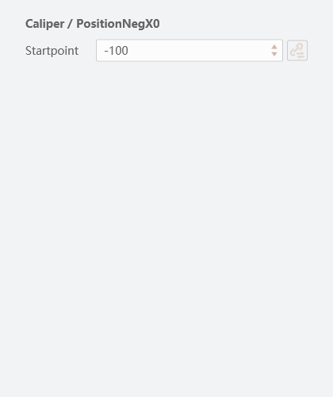

# 公共配置链路审查节点

本节点按原厂源码关闭五项具体问题，完整路径、行号、摘录、哈希、复现步骤和边界见 [configuration-review-fixes.json](configuration-review-fixes.json)。

| 项目 | 结果 |
|---|---|
| 隐藏已订阅行错误切回数字编辑模式 | 清绑后保留 IsSub 与 @ 用户态；读取真实数值并同步已提交基线 |
| 参数写入回调未生效却宣称成功 | 主代理补写后核对；模型消化已接受返回值，失败不运行 |
| TabType=1 的 Panal 被当普通分组表 | 按 Category.Items 展平后仅渲染 Collection[0]，Grid/零边距；禁止订阅；未知复杂首项明确 Unsupported |
| 清绑失败时本地身份被伪清空 | Error/异常保留真实绑定与显示，仍执行隐藏请求；同步宿主异常转 typed OperationError |
| Int32 十六进制符号及范围/步长错误 | 严格按已确认 CLR 类型规范实例状态，原始定义不改写；不泛化 Float/String/Int64 |

验证：StateChecks 1687、ViewChecks 174、IntegerMetadataChecks 92、OperationChecks 16 项通过。原厂 VM.Util.ParseInt 直接运行确认12组转换结果，反射确认五个 Integer 字段为 Int32；没有设备测试。

下图均为独立实现依据原厂资源/源码生成的隔离控件截图，**不是原厂桌面截图**，不能用于宣称像素或全部运行等价。

此节点不包含 ColorSegmentList 等复杂面板内容、未有宿主能力的 Global/索引/父容器服务，也不扩展其他工具逆向。详细未闭合边界已列入 JSON。
